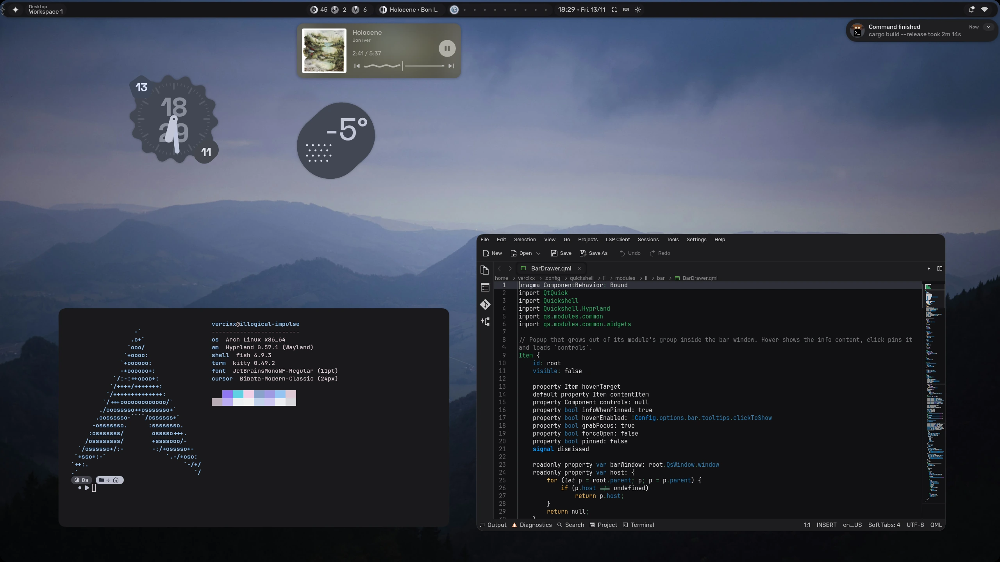
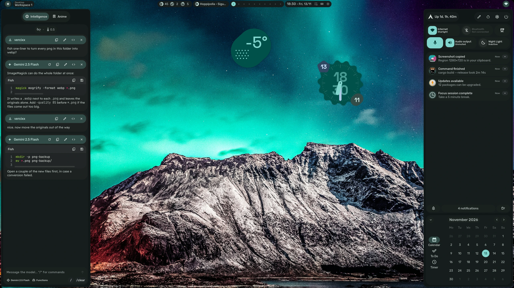
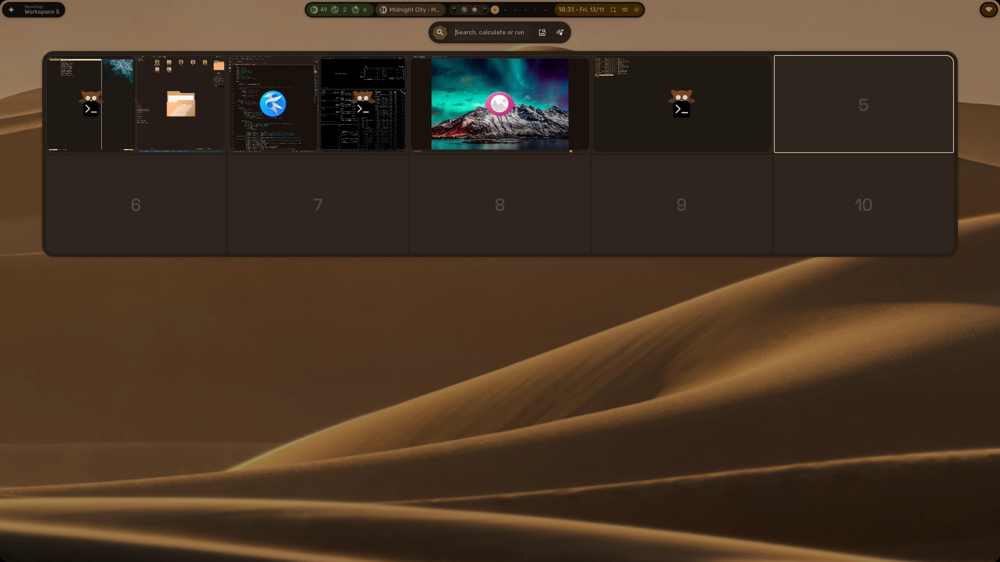
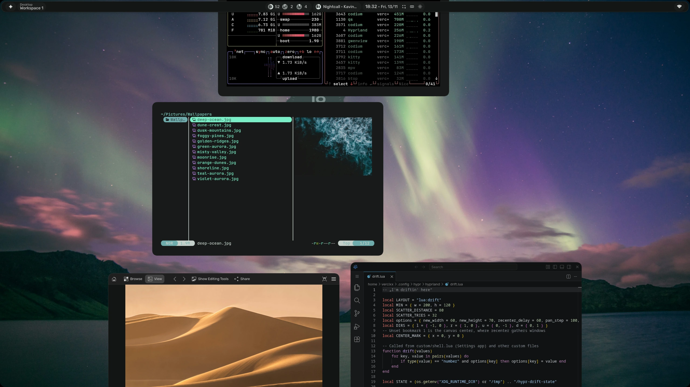
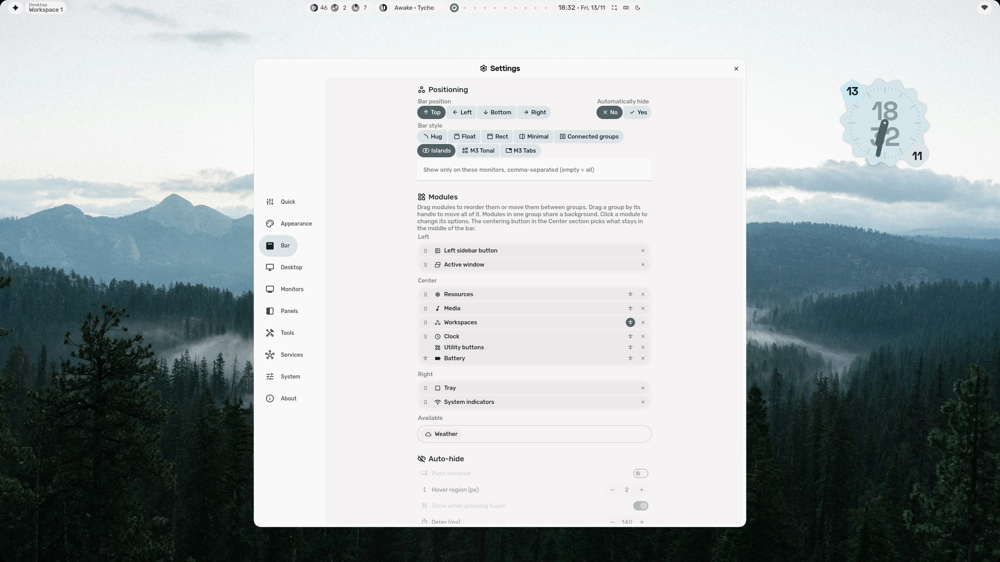
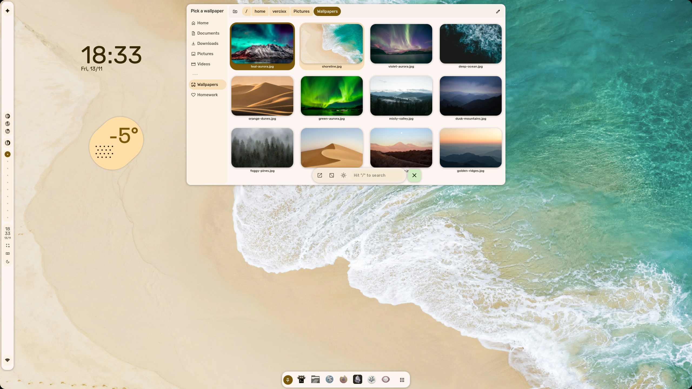
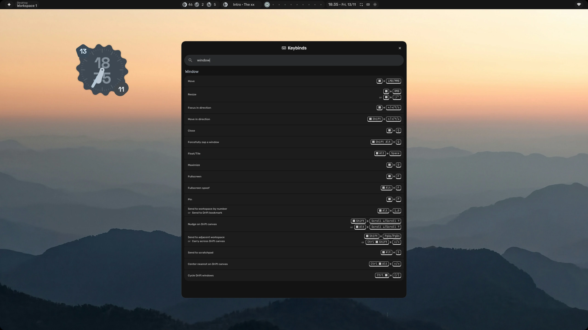
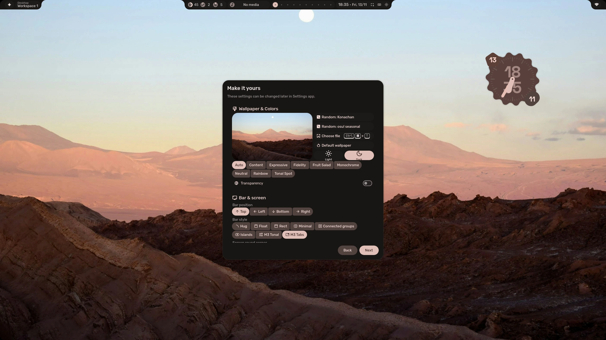
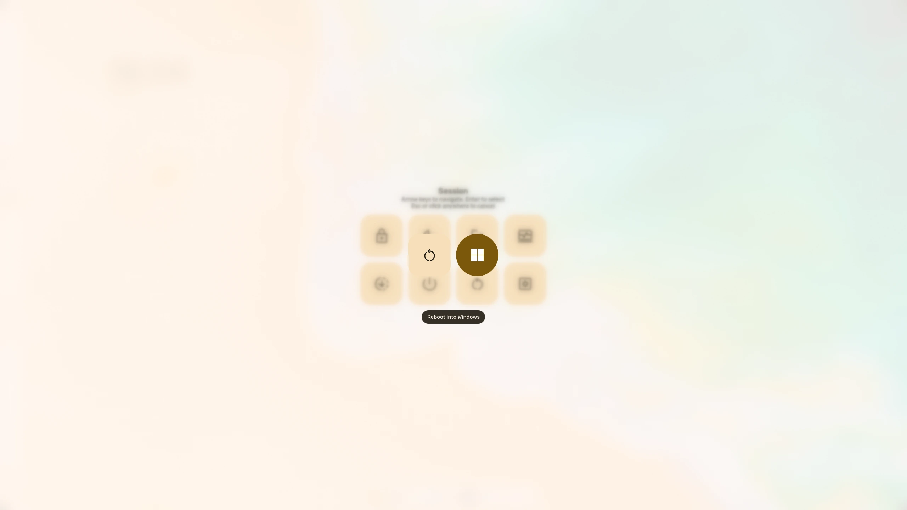

<div align="center">

## 

**Opinionated fork of [end-4's](https://github.com/end-4/dots-hyprland) usability-first dotfiles**
</div>

---

<div align="center"> 
</div>

<div align="center">
    <h2>Screenshots</h2>
    <h3></h3>
</div>

<div align="center">



| **AI chat and sidebars** | **Overview** |
|:--:|:--:|
|  |  |
| **Drift, the not-tiling layout** | **Bar styles and layout editor** |
|  |  |
| **Light mode with a vertical bar** | **Keybind cheatsheet with search** |
|  |  |
| **Onboarding** | **Reboot straight into Windows** |
|  |  |

<sub>Wallpapers from Unsplash by [Leonie Zettl](https://unsplash.com/photos/swGD6c8XYHM), [Jussi Hellsten](https://unsplash.com/photos/1uwLmA5LFfg), [Zetong Li](https://unsplash.com/photos/HEf0fKgJA1Q), [Jonatan Pie](https://unsplash.com/photos/e2MnKlEFcTg), [Roberto Shumski](https://unsplash.com/photos/oYEGPZebzGw), [Reinis Birznieks](https://unsplash.com/photos/lu5uhEAy2lI), [Sudhanshu Chaurasia](https://unsplash.com/photos/uljyiw752gc) and [Parsing Eye](https://unsplash.com/photos/mPFjvk44pIE).</sub>
</div>

---

<div align="center">
    <h2>Installation</h2>
</div>

> [!IMPORTANT]
> Setup script overrides ALL existing installations of dotfiles.<br>
> This includes original dots and all forks of it.<br>
> Please make a backup before proceeding. You've been warned.

This is pretty much the same as original dotfiles. Run this in your terminal:
```
mkdir -p ~/.cache/illogical-impulse
git clone --recurse-submodules https://github.com/Vercixx/illogical-impulse.git ~/.cache/illogical-impulse
cd ~/.cache/illogical-impulse
./setup install
```

<div align="center">
    <h2>Credits</h2>
    <h3></h3>
</div>

- Huge thanks to **[@end-4](https://github.com/end-4), [@clsty](https://github.com/clsty), and [all other contributors](https://github.com/end-4/dots-hyprland/graphs/contributors?all=1)** for making [dots-hyprland / illogical-impulse shell](https://github.com/end-4/dots-hyprland)! Your work is appreciated!
- Also shoutout to **[@pctrade](https://github.com/pctrade)** for some of the ideas used in his fork!

<div align="center">
    <h2>Copying</h2>
</div>

You can fork this if you want. Both [upstream](https://github.com/end-4/dots-hyprland/blob/main/LICENSE) and this fork are licensed under GPL-3.0. You can do anything you want with this for as long as you follow the license ;)
